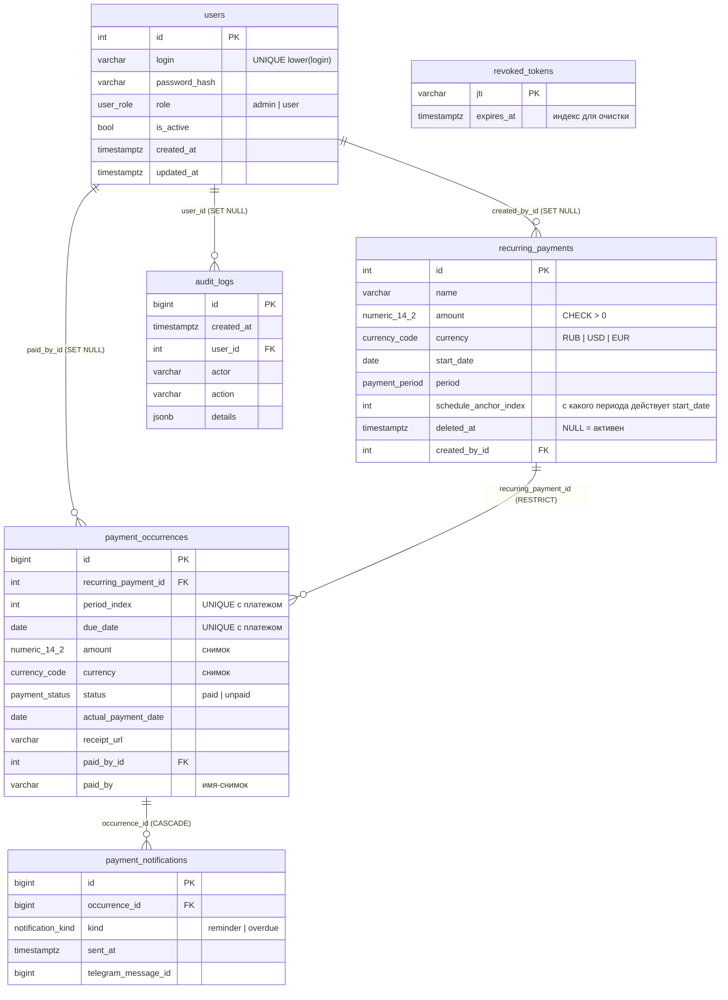

# База данных (PostgreSQL 16)

Схема создаётся миграциями Alembic (`alembic/versions/`), модели — `app/models.py`.
Тест `tests/test_migrations.py` падает, если модели и миграции разошлись.

## ER-диаграмма



## Ключевые решения

**Шаблон и периоды разделены.** `recurring_payments` — что и как часто платим, `payment_occurrences` — каждый конкретный
срок со своим статусом. История не пересчитывается: `amount`/`currency` в периоде — осознанный снимок на момент создания,
поэтому изменение шаблона не меняет прошлые периоды.

**Инварианты держит сама БД**, а не только код (их нельзя обойти скриптом, ручным SQL или багом):

| Правило | Как защищено |
|---|---|
| сумма > 0 | `CHECK amount > 0` (платежи и периоды) |
| «оплачено» ⇔ есть фактическая дата | `CHECK (status='paid') = (actual_payment_date IS NOT NULL)` |
| «кто оплатил» только у оплаченных | `CHECK status='paid' OR (paid_by IS NULL AND paid_by_id IS NULL)` |
| один период с данным номером/сроком у платежа | `UNIQUE (recurring_payment_id, period_index)` и `(…, due_date)` |
| логин уникален без учёта регистра | уникальный функциональный индекс `lower(login)` |
| ровно один активный админ | частичный уникальный индекс по `role WHERE role='admin' AND is_active` |
| одно оповещение на (период, вид) | `UNIQUE (occurrence_id, kind)` |
| название не пустое | `CHECK char_length(btrim(name)) > 0` |

**Типы.** Время — `timestamptz` (UTC), «календарные» даты — `date`, деньги — `numeric(14,2)`, статусы/валюты/периоды —
нативные `ENUM`, детали аудита — `jsonb`. Ключи — `IDENTITY`; для растущих таблиц (`payment_occurrences`,
`payment_notifications`, `audit_logs`) — `bigint`.

**Внешние ключи с осмысленным `ON DELETE`.**
- `payment_occurrences → recurring_payments`: `RESTRICT` — историю нельзя потерять, платежи удаляются «мягко»;
- ссылки на пользователя (`created_by_id`, `paid_by_id`, `audit_logs.user_id`): `SET NULL` — удаление пользователя не ломает
  историю, а имя оплатившего остаётся в `paid_by` (для оплат из Telegram там `@username`);
- `payment_notifications → payment_occurrences`: `CASCADE` — журнал оповещений живёт и умирает вместе с периодом.

**Мягкое удаление — одно поле `deleted_at`.** Раньше были `is_deleted` + `deleted_at`, которые могли разойтись.
В коде `is_deleted` — вычисляемое свойство (`deleted_at IS NOT NULL`), API не изменилось.

**Оповещения вынесены в `payment_notifications`.** Раньше в периоде лежали четыре колонки
(`reminder_sent_at`, `overdue_notice_sent_at` и два `*_message_id`). Теперь запись «оповещение отправлено» — отдельная
строка, а «занять» его = `INSERT … ON CONFLICT DO NOTHING` по `UNIQUE (occurrence_id, kind)`. Это атомарно даже при
нескольких запущенных экземплярах бэкенда (проверено тестом на 24 параллельных потоках: победитель ровно один).
Новые каналы/виды оповещений добавляются без изменения таблицы периодов.

**Индексы — под реальные запросы.**
- `ix_payment_occurrences_unpaid_due` — частичный (`WHERE status='unpaid'`): напоминания, просрочки, `/upcoming`, `/overdue`;
- `ix_payment_occurrences_due_date` — диапазоны сроков (сводки, бюджет, фильтры);
- индексы на всех внешних ключах, `audit_logs (action, created_at)` и `(created_at)`;
- лишний индекс по `status` (всего 2 значения) убран; индекс по `recurring_payment_id` не нужен — его покрывает `UNIQUE`.

**Конкурентность.** Генерация новых периодов (`ensure_occurrences`) идёт под `pg_advisory_xact_lock`, поэтому несколько
процессов не создадут один период дважды (и в любом случае это запретил бы `UNIQUE`).
Итоги по валютам считает сама БД одним `GROUP BY` (раньше — цикл по всем строкам в Python).

## Работа с миграциями

```bash
alembic upgrade head                           # применить миграции
alembic revision --autogenerate -m "описание"  # новая миграция после правки app/models.py
alembic downgrade -1                           # откатить последнюю
alembic check                                  # есть ли расхождение моделей и БД
```

Перенос данных из старой SQLite-базы: `scripts/migrate_sqlite_to_postgres.py` (см. backend/README.md).
